# Creative Stack User Guide

A complete reference and practitioner handbook for the **Creative Stack**: eight portable media-production skills, 47 CLI tools, five headless GUI application bridges, three opt-in MCP servers, and a single brand token source (`brand/tokens.json`) across macOS, Arch Linux, and Debian/Ubuntu.

> **Personal project. Not an official Google product.** Google doesn't support Creative Stack,
> and it isn't affiliated with or endorsed by Google. It is provided as is under Apache-2.0. Commands
> that call Gemini or Vertex AI use your own credentials and are billed to your own account. See the
> README's [Disclaimer](../README.md#disclaimer) and [what leaves the machine](../README.md#security).

---

## Table of Contents

1. [Architecture & Design Principles](#1-architecture--design-principles)
2. [Environment & Harness Wiring](#2-environment--harness-wiring)
3. [Brand Token System (`brand/tokens.json`)](#3-brand-token-system-brandtokensjson)
4. [Skill-by-Skill Reference & Workflows](#4-skill-by-skill-reference--workflows)
   - [`/shot` — Screenshots, Callouts & Browser Frames](#41-shot--screenshots-callouts--browser-frames)
   - [`/vidkit` — Video Jump-Cuts, Captions, Motion Graphics & NLE Timelines](#42-vidkit--video-jump-cuts-captions-motion-graphics--nle-timelines)
   - [`/deck` — Slide Decks in Marp, Reveal.js & Typst](#43-deck--slide-decks-in-marp-revealjs--typst)
   - [`/vector` — Diagrams (D2, Mermaid, Graphviz, PlantUML), SVG & Tracing](#44-vector--diagrams-d2-mermaid-graphviz-plantuml-svg--tracing)
   - [`/raster` — Batch Edits, Responsive Ladders, Cutouts & SAM 2 Segmentation](#45-raster--batch-edits-responsive-ladders-cutouts--sam-2-segmentation)
   - [`/render3d` — Headless Blender Cycles/EEVEE, 3D Logos & Turntables](#46-render3d--headless-blender-cycleseevee-3d-logos--turntables)
   - [`/cad` — Parametric 3D Parts & Slicer-Ready STL / 3MF / STEP](#46b-cad--parametric-3d-parts--slicer-ready-stl--3mf--step)
   - [`/sound` — Speech Cleanup, Procedural Music Beds, Sidechain Ducking & Reaper](#47-sound--speech-cleanup-procedural-music-beds-sidechain-ducking--reaper)
   - [`/artgen` — Generative Images, Video, TTS Narration, Music & Grounded Research](#48-artgen--generative-images-video-tts-narration-music--grounded-research)
5. [End-to-End Multi-Skill Recipes](#5-end-to-end-multi-skill-recipes)
6. [MCP Servers & Interactive GUI Bridges](#6-mcp-servers--interactive-gui-bridges)
7. [Diagnostics, Verification & Troubleshooting](#7-diagnostics-verification--troubleshooting)

---

## 1. Architecture & Design Principles

Creative Stack turns media production into deterministic, inspectable pipelines that work identically when invoked by a human in a terminal or by an AI coding agent via `/skill` commands.

```mermaid
flowchart LR
    subgraph Tokens["Single Source of Truth"]
        BT["brand/tokens.json"]
    end

    subgraph Skills["Eight Agent Skills"]
        S1["/shot"]
        S2["/vector"]
        S3["/raster"]
        S4["/render3d"]
        S5["/sound"]
        S6["/artgen"]
        S7["/vidkit"]
        S8["/deck"]
    end

    subgraph Intermediates["Reviewable Intermediates"]
        I1[".anot8.json"]
        I2[".d2 / .mmd / .dot"]
        I3["cut.json / .srt / .ass"]
        I4[".motion.json / .plan.json"]
        I5["edit.xml / .rpp / deck.md"]
    end

    subgraph Outputs["Published Deliverables"]
        O1["PNG / WebP / AVIF / SVG"]
        O2["H.264 MP4 / ProRes 4444 / GIF"]
        O3["WAV / MP3 / M4A (-14 LUFS)"]
        O4["PDF / HTML / PPTX"]
    end

    BT --> Skills
    Skills --> Intermediates
    Intermediates --> Outputs
```



### Core Invariants

1. **Reviewable Intermediates Before Pixels**: Every non-trivial operation writes a plain-text specification (`cut.json`, `.anot8.json`, `.srt`, `.ass`, `.motion.json`, `.plan.json`, `deck.md`, `edit.xml`, `.rpp`) before rendering final media. Fixing a typo, adjusting a timestamp, or dropping a bad take is a text edit rather than a full re-capture.
2. **One Brand Token File**: Colours, typography, callout dimensions, shadow softness, caption rules, and audio loudness targets (`-14 LUFS` integrated, `-1.0 dBTP` true peak) live in `brand/tokens.json`.
3. **Three Portability Chokepoints**:
   - `packages/manifest.json` defines every package across Homebrew, pacman/AUR, and apt, plus `cargo`/`npm`/`uv`/`font-release` fallbacks and the binaries each package `provides`.
   - `scripts/hostenv.py` resolves OS family, display server (`quartz`/`wayland`/`x11`/`headless`), OS secret store (`keychain`/`libsecret`/`file`), and headless app binaries.
   - `config/harnesses.json` maps every supported AI assistant (Claude Code, OpenAI Codex, Gemini CLI, Antigravity IDE, Antigravity CLI, Universal Agent Hub, Cursor) to its skill directories, registry files, and MCP configuration dialect.
4. **Zero Repo Secrets**: API keys live in the OS keychain (`security` on macOS, `secret-tool` on Linux, or `0600` `~/.config/creative-stack/secrets.env`) and are exported into `os.environ` at runtime.

---

## 2. Environment & Harness Wiring

### Shell Environment (`creative-stack.env`)

Running `./scripts/bootstrap.sh` or `python3 scripts/install_bridges.py` generates `creative-stack.env` at the repository root. Source it in `~/.zshrc` (or `~/.zshconfig/zsh.d/creative-stack.zsh`):

```bash
source "/path/to/creative-stack/creative-stack.env"
export GOOGLE_CLOUD_PROJECT="your-gcp-project"
export GOOGLE_CLOUD_LOCATION="global"
```

What `creative-stack.env` sets up:
- Pre-pends `~/.local/bin` to `PATH` so headless wrapper scripts (`blender`, `inkscape`, `gimp-console`, `gimp-app`, `kdenlive`, `soffice`) are discoverable without symlink-breaking macOS `.app` bundle plug-in resolution.
- Exports `CREATIVE_STACK_ROOT` and `CREATIVE_STACK_SOUNDFONT` (`assets/soundfonts/FluidR3Mono_GM.sf3`).

### Supported Harnesses

`python3 scripts/sync_skills.py` links all eight skills into every installed agent harness defined in `config/harnesses.json`:

| Harness | Skill Symlink Locations | Skill Registry | Project MCP Config Path |
| :--- | :--- | :--- | :--- |
| **Claude Code (`claude`)** | `~/.claude/skills` | — | `.mcp.json` (project, pending approval) |
| **OpenAI Codex (`codex`)** | `~/.agents/skills` | — | User-scope only (`~/.codex/config.toml` not written; prints `codex mcp add`) |
| **Gemini CLI (`gemini`)** | `~/.gemini/skills` | — | `.gemini/settings.json` (project) |
| **Antigravity IDE** | `~/.gemini/config/skills` | `~/.gemini/config/skills.json` | User-scope only (`~/.gemini/config/mcp_config.json` not written; prints hint) |
| **Antigravity CLI (`agy`)** | `~/.gemini/antigravity-cli/skills` | — | — |
| **Universal Agent Hub** | `~/.agents/skills` | `~/.agents/skills.json` | — |
| **Cursor** | Reads `~/.claude/skills` | — | `.cursor/mcp.json` (project) |

All eight skills set `disable-model-invocation: true` in their `SKILL.md` frontmatter so they act as explicit slash commands (`/shot`, `/vidkit`, `/deck`, `/vector`, `/raster`, `/render3d`, `/sound`, `/artgen`) rather than firing unprompted during unrelated coding work.

---

## 3. Brand Token System (`brand/tokens.json`)

Every script loads `brand/tokens.json` via `scripts/brand.py`. Override the active brand profile on any command with `--brand <path-or-name>` or `export CREATIVE_STACK_BRAND=<path>`.

| Token Group | Key Properties | Consumed By |
| :--- | :--- | :--- |
| `color.light` / `color.dark` | `bg`, `surface`, `surfaceAlt`, `text`, `textMuted`, `accent`, `accentHover`, `border`, `codeBg` | All visual skills (`--mode light\|dark`) |
| `color.brand` | `blue` (`#4285F4`), `red` (`#EA4335`), `yellow` (`#FBBC04`), `green` (`#34A853`) | `/vector`, `/deck`, `/vidkit`, `/render3d` |
| `gradient` | `hero`, `warm`, `subtle`, `dusk` | `/shot frame.py`, `/raster cutout.py`, `/render3d`, `/vidkit motion.py` |
| `font` | `display`, `body`, `mono` | `/shot`, `/vidkit`, `/deck`, `/vector` |
| `screenshot` | `deviceScaleFactor` (`2`), `viewport` (`[1440, 900]`), `padding` (`64`), `cornerRadius` (`12`), `calloutColor` (`#EA4335`), `calloutStroke` (`3`) | `/shot capture.py`, `/shot frame.py` |
| `video` | `resolution` (`[1920, 1080]`), `fps` (`30`), `safeMargin` (`64`), `captionFont`, `captionSize` (`42`), `loudnessTarget` (`-14`), `truePeak` (`-1.0`) | `/vidkit captions.py`, `/vidkit motion.py`, `/vidkit publish.py`, `/sound clean.py`, `/sound mix.py` |

Inspect resolved tokens or export Marp CSS at any time:

```bash
python3 scripts/brand.py
python3 scripts/brand.py --css > out/theme.css
```

---

## 4. Skill-by-Skill Reference & Workflows

> **Python Environment Note**: For commands that use Playwright (`capture.py`, `frame.py`, `motion.py`), Pillow (`image.py`, `cutout.py`, `segment.py`), `rembg` (`cutout.py`), `torch`/`transformers` (`segment.py`), or `google-genai` (`artgen`), invoke via `.venv/bin/python` (or activate `.venv`).

---

### 4.1 `/shot` — Screenshots, Callouts & Browser Frames

Produces crisp 2x Retina screenshots, numbered callout overlays, privacy redactions, and gradient browser frames.

#### Scripts & Capabilities

| Script | Purpose | Key Flags |
| :--- | :--- | :--- |
| `skills/shot/scripts/capture.py` | Headless Chromium capture at `@2x` DPI with CSS transition freezing, cookie-banner hiding, and selector waiting | `--url <url>`, `-o <png>`, `--selector <css>`, `--wait-for <css>`, `--dark`, `--keep-banners` |
| `anot8` (npm CLI + MCP server) | Callouts (`box`, `ellipse`, `arrow`, `text`, `pin`) and borderless `blur`/`highlight` from a JSON spec; every render prints each mark's pixel bounds | `init <png> --palette <json>`, `render <spec> -o <png> --md <notes>`, `apply <spec> --ops <json>`, `validate <spec>` |
| `skills/shot/scripts/scan.py` | OCRs a screenshot (tesseract) and adds an anot8 `blur` for each key, labelled value, email, GCP project id, card number or random-looking string; `--ai` adds Gemini for faces, avatars, names and pickers; reports only a masked preview of each hit | `-i <png>`, `--spec <anot8.json>`, `--check`, `--ai`, `--json <path>` |
| `skills/shot/scripts/frame.py` | Wraps a screenshot in a window or browser chrome over a brand gradient card with shadow | `-i <png>`, `-o <png>`, `--chrome window\|browser\|none`, `--url <str>`, `--backdrop subtle\|hero\|warm\|dusk`, `--caption <str>` |

#### Concrete Workflow

```bash
# 1. Annotate a screenshot from an anot8 spec (callouts plus a blurred token)
anot8 render fixtures/steps.anot8.json -o out/hero-annotated.png

# 2. Place inside a browser frame on the brand hero gradient
.venv/bin/python skills/shot/scripts/frame.py \
  -i out/hero-annotated.png -o out/hero-framed.png \
  --chrome browser --url "console.cloud.google.com" \
  --backdrop hero --caption "Deploy in 90 seconds"
```

---

### 4.2 `/vidkit` — Video Jump-Cuts, Captions, Motion Graphics & NLE Timelines

Automates talking-head and screencast post-production while keeping every editorial decision in editable JSON/SRT/XML files.

#### Scripts & Capabilities

| Script | Purpose | Key Flags |
| :--- | :--- | :--- |
| `skills/vidkit/scripts/analyze.py` | Sends a lightweight proxy clip to Gemini to propose chapters, highlights, fumbles/cuts, and B-roll prompts (`analysis.json`) | `-i <mp4>`, `-o <analysis.json>`, `--transcript <json/srt>`, `--notes <str>` |
| `skills/vidkit/scripts/autocut.py` | Detects silences (`silencedetect`), merges optional `analysis.json`, cuts filler words (`--fillers`), writes an editable `cut.json` decision list, and renders a jump-cut MP4 | `-i <mp4>`, `-o <cut.json>`, `--render <mp4>`, `--srt <srt>`, `--srt-out <srt>`, `--analysis <json>`, `--fillers <talk.json>`, `--filler-words <list>`, `--threshold -35`, `--min-silence 0.5` |
| `skills/vidkit/scripts/vidscan.py` | Samples frames (`--fps`, default 1), OCRs each with `/shot`'s scan rules, joins hits into time-ranged tracks and blurs each box while it is on screen; `--check` gates the final render; reports only a masked preview | `-i <mp4>`, `--json <tracks.json>`, `--from-json <tracks.json>`, `--render <mp4>`, `--check`, `--fps 1` |
| `skills/vidkit/scripts/zoom.py` | Detects frame-to-frame motion centroids and rides a smooth push-in zoom onto active terminal/UI areas (`zoom.yaml` intermediate) | `-i <mp4>`, `--auto`, `--spec-out <zoom.yaml>`, `--spec <zoom.yaml>`, `-o <mp4>`, `--zoom 1.5` |
| `skills/vidkit/scripts/transcribe.py` | Local speech-to-text via `whisper-cli`, emitting `.srt`, `.vtt`, `.txt`, and word-timed `.json` | `-i <media>`, `-o <prefix>`, `--model small.en`, `--vocab <terms>`, `--fillers` (keep um/uh, DTW timings), `--vad` |
| `skills/vidkit/scripts/captions.py` | Converts `.srt` into brand-styled `.ass` subtitles (`outline`, `box`, `pill`, `karaoke`, `highlight`) and burns them in or muxes a soft track | `-i <mp4>`, `-s <srt>`, `-o <mp4>`, `--style outline\|box\|pill\|karaoke\|highlight`, `--words <json>`, `--soft`, `--ass-only` |
| `skills/vidkit/scripts/motion.py` | Frame-accurate HTML/CSS motion graphics (`title`, `lower-third`, `end-card`) via Web Animations API seek + ffmpeg | `-t title\|lower-third\|end-card`, `-o <mp4/mov/webm>`, `--param k=v`, `--alpha`, `--overlay-on <mp4>`, `--at <sec>` |
| `skills/vidkit/scripts/timeline.py` | Exports a Kdenlive / MLT timeline (`edit.mlt`, with optional headless `melt` render), or OpenTimelineIO FCP7 XML (`edit.xml`), EDL, or OTIO | `-s <cut.json>`, `-o <edit.mlt\|edit.xml>`, `--render <mp4>`, `--chapters <txt>`, `--markers gaps\|none` |
| `skills/vidkit/scripts/publish.py` | Two-pass EBU R128 loudness normalisation, multi-height H.264/VP9 encode ladder (`1080p`, `720p`, `480p`), chapter metadata, and poster frame | `-i <mp4>`, `-o <dir>`, `--heights 1080 720 480`, `--chapters <txt>`, `--webm`, `--thumb-at <sec>` |

#### Concrete Workflow

```bash
# 1. Cut dead air and write a reviewable cut list + preview MP4
.venv/bin/python skills/vidkit/scripts/autocut.py \
  -i fixtures/rec.mp4 -o out/cut.json --render out/cut.mp4

# 2. Burn word-by-word brand karaoke captions
.venv/bin/python skills/vidkit/scripts/captions.py \
  -i out/cut.mp4 -s out/demo.srt -o out/cut-captioned.mp4 --style karaoke

# 3. Render a brand-styled HTML/CSS title card
.venv/bin/python skills/vidkit/scripts/motion.py \
  -t title -o out/title-card.mp4 --duration 2.0 \
  --param kicker="Creative Stack" \
  --param title="Ship faster with 8 skills"

# 4. Export an NLE timeline for Kdenlive / headless melt (or FCP7 XML)
.venv/bin/python skills/vidkit/scripts/timeline.py \
  -s out/cut.json -o out/edit.mlt
```

---

### 4.3 `/deck` — Slide Decks in Marp, Reveal.js & Typst

Turns structured Markdown outlines into brand-themed PDFs, self-contained HTML decks, editable PPTX presentations, or PNG slide strips.

#### Scripts & Capabilities

| Script | Purpose | Key Flags |
| :--- | :--- | :--- |
| `skills/deck/scripts/outline.py` | Converts a heading/bullet Markdown outline (`#` title, bare `##` section dividers, `##` with bullets slides) into a structured Marp deck | `-i <outline.md>`, `-o <deck.md>`, `--footer <text>`, `--dark`, `--notes`, `--profile <brand>` |
| `skills/deck/scripts/build.py` | Compiles `deck.md` into PDF, self-contained HTML, editable PPTX (`--editable`), or per-slide PNGs with brand CSS from `brand/tokens.json` | `-i <deck.md>`, `-o <pdf/html/pptx/png>`, `--editable`, `--notes`, `--profile <brand>` |
| `skills/deck/scripts/theme.py` | Generates standalone Marp/Reveal CSS theme stylesheets from `brand/tokens.json` | `--profile <brand>`, `--stdout` |

#### Concrete Workflow

```bash
# 1. Expand a plain Markdown outline into a Marp slide deck
.venv/bin/python skills/deck/scripts/outline.py \
  -i fixtures/outline.md -o out/deck.md --footer "Creative Stack"

# 2. Build PDF and self-contained HTML decks
.venv/bin/python skills/deck/scripts/build.py -i out/deck.md -o out/deck.pdf
.venv/bin/python skills/deck/scripts/build.py -i out/deck.md -o out/deck.html
```

---

### 4.4 `/vector` — Diagrams (D2, Mermaid, Graphviz, PlantUML), SVG & Tracing

Renders text-based architecture and sequence diagrams with brand colours and typography, optimises and converts SVGs, and traces bitmap logos into clean vector curves.

#### Scripts & Capabilities

| Script | Purpose | Key Flags |
| :--- | :--- | :--- |
| `skills/vector/scripts/diagram.py` | Unified diagram compiler auto-detecting `.d2`, `.mmd`, `.dot`, and `.puml`, injecting `brand/tokens.json` palette & fonts | `-i <file>`, `-o <svg/png/pdf>`, `--theme light\|dark`, `--direction right\|left\|down\|up`, `--scale 2`, `--optimise` |
| `skills/vector/scripts/svg.py` | Four essential SVG operations: `optimise` (SVGO preserving `viewBox`), `export` (`resvg`/Inkscape to PNG/PDF), `text-to-path` (Inkscape), `recolor` (snap hex codes to brand palette) | `-i <svg/dir>`, `-o <out>`, `--op optimise\|export\|text-to-path\|recolor`, `--width <px>`, `--to-brand` |
| `skills/vector/scripts/trace.py` | Converts raster logos/icons into smooth SVG paths via Potrace + ImageMagick colour quantisation | `-i <png/jpg>`, `-o <svg>`, `--mode bw\|color`, `--colors 4`, `--fill brand.blue` |
| `skills/vector/scripts/sprite.py` | Folds a directory of SVG icons into a single namespaced `<symbol>` sprite with optional `--currentcolor` and contact sheet | `-i <dir>`, `-o <icons.svg>`, `--prefix ui-`, `--currentcolor`, `--contact-sheet <png>` |

#### Concrete Workflow

```bash
# 1. Render a D2 architecture diagram to brand-styled SVG and 2x PNG
.venv/bin/python skills/vector/scripts/diagram.py -i arch.d2 -o out/arch.svg
.venv/bin/python skills/vector/scripts/diagram.py -i arch.d2 -o out/arch.png

# 2. Optimise SVG with SVGO while keeping viewBox intact
.venv/bin/python skills/vector/scripts/svg.py -i out/arch.svg -o out/arch-opt.svg --op optimise
```

---

### 4.5 `/raster` — Batch Edits, Responsive Ladders, Cutouts & SAM 2 Segmentation

Single-pass ImageMagick/libvips pipelines, responsive `` ladders, neural background removal (`rembg`), and open-vocabulary/box-prompted SAM 2 segmentation (`segment.py`).

#### Scripts & Capabilities

| Script | Purpose | Key Flags |
| :--- | :--- | :--- |
| `skills/raster/scripts/edit.py` | Single-invocation ImageMagick pipeline across one file or a folder | `-i <file/dir>`, `-o <file/dir>`, `--ops "trim,crop:16x9,resize:1600,round:16,shadow,border:2:#DADCE0,strip"` |
| `skills/raster/scripts/ladder.py` | Generates multi-width (`480,960,1440`) multi-format (`webp,avif,png`) derivatives + `manifest.json` with ready-to-paste `<picture>`/`srcset` markup (never upscales) | `-i `, `-o <dir>`, `--widths 480,960,1440`, `--formats webp,png` |
| `skills/raster/scripts/cutout.py` | Neural subject isolation via `rembg` (`birefnet-general`, `u2net`, `isnet-general-use`), optional tight trim, padding, and brand gradient backdrop | `-i `, `-o <png/dir>`, `--model birefnet-general`, `--backdrop hero`, `--pad 80`, `--shadow` |
| `skills/raster/scripts/segment.py` | Two-stage Gemini object detection (`.segments.json` intermediate) + local SAM 2 mask refinement and video object tracking (`blur`, `pixelate`, `fill`, `erase`, `inpaint` to remove an object by filling from its surroundings, `--cutout`) | `-i `, `-q <description>`, `-o <out>`, `--op blur\|pixelate\|fill\|erase\|inpaint`, `--inpaint local\|gemini`, `--cutout <png>`, `--refine sam2`, `--from-json <json>` |

#### Concrete Workflow

```bash
# 1. Apply rounded corners, brand drop shadow, and metadata stripping in one pass
.venv/bin/python skills/raster/scripts/edit.py \
  -i out/hero-annotated.png -o out/hero-card.png \
  --ops "resize:960,round:16,shadow,strip"

# 2. Generate responsive WebP + oxipng-optimised PNG derivatives and srcset manifest
.venv/bin/python skills/raster/scripts/ladder.py \
  -i out/hero-annotated.png -o out/ladder/ \
  --widths 480,960 --formats webp,png
```

---

### 4.6 `/render3d` — Headless Blender Cycles/EEVEE, 3D Logos & Turntables

Drives headless Blender 5.x (`~/.local/bin/blender -b`) with three-point studio lighting, Apple Silicon Metal GPU acceleration, filmic colour management, and brand materials.

#### Scripts & Capabilities

| Script | Purpose | Key Flags |
| :--- | :--- | :--- |
| `skills/render3d/scripts/logo3d.py` | Extrudes and bevels a flat path SVG into 3D with brand materials, rendering a still PNG or a 60-degree ease-in/ease-out rock sting | `-i <logo.svg>`, `-o <png/mp4>`, `--spin`, `--frames 60`, `--depth 0.08`, `--bevel 0.004`, `--material accent`, `--engine cycles\|eevee`, `--gpu`, `--transparent` |
| `skills/render3d/scripts/render.py` | Renders a `.blend`, `.glb`, `.gltf`, `.obj`, `.fbx`, or FreeCAD `.stl` model with automatic camera framing (`three-quarter`, `front`, `iso`), 3-point studio lighting, or 360-degree `--turntable` video | `-i <model>`, `-o <png/mp4>`, `--view three-quarter\|front\|iso`, `--turntable`, `--frames 90`, `--material blue`, `--backdrop hero`, `--engine cycles\|eevee`, `--samples 96`, `--gpu` |

#### Concrete Workflow (including FreeCAD Parametric CAD → Blender Raytrace)

```bash
# 1. Build a parametric 3D solid in headless FreeCAD (freecadcmd) -> .step & .stl
/Applications/FreeCAD.app/Contents/Resources/bin/freecadcmd build_part.py

# 2. Render studio 3-quarter shot, orthographic isometric view, and 360° turntable in Blender
.venv/bin/python skills/render3d/scripts/render.py \
  -i part.stl -o out/part-studio.png --view three-quarter --material blue --backdrop hero --gpu
.venv/bin/python skills/render3d/scripts/render.py \
  -i part.stl -o out/part-iso.png --view iso --mode dark --gpu
.venv/bin/python skills/render3d/scripts/render.py \
  -i part.stl -o out/part-spin.mp4 --turntable --frames 60 --gpu

# 3. Extrude a 2D SVG logo into 3D
.venv/bin/python skills/render3d/scripts/logo3d.py \
  -i flat-logo.svg -o out/logo3d.png --engine cycles --samples 64 --gpu
```

---

### 4.6b `/cad` — Parametric 3D Parts & Slicer-Ready STL / 3MF / STEP

Designs dimensionally accurate mechanical parts in millimetres via OpenCASCADE (`build123d`), drops them onto `Z = 0` for the print bed, verifies watertight manifold topology and overhangs, exports `.stl` + `.3mf` + `.step`, and bridges `.fcstd`/`.iges` via optional `freecadcmd`.

#### Scripts & Capabilities

| Script | Purpose | Key Flags |
| :--- | :--- | :--- |
| `skills/cad/scripts/build.py` | Compiles `part.py` + `params.json` -> bed-aligned `.stl`, `.3mf`, `.step` + printability gate + `/render3d` preview | `-s <part.py>`, `-p <params.json>`, `--set key=val`, `-o <stem>`, `--bed 256x256x256`, `--preview <png>` |
| `skills/cad/scripts/check.py` | Verifies manifoldness, connected solid count, mm bounds, bed contact area, and steep overhangs (`>45°`) | `-i <stl/3mf/step>`, `--bed <WxDxH>`, `--expected-parts 1`, `--max-overhang 45`, `--json <report.json>` |
| `skills/cad/scripts/convert.py` | Converts between `.step`, `.iges`, `.fcstd`, `.stl`, and `.3mf` (`build123d` + `freecadcmd` fallback) | `-i <src>`, `-o <dst>`, `--tolerance 0.01` |

#### Concrete Workflow

```bash
# Build a parametric M3 bracket, verify manifold + bed contact, and render an isometric preview
.venv/bin/python skills/cad/scripts/build.py \
  -s out/cad-smoke/part.py -p out/cad-smoke/params.json \
  -o out/cad-smoke/bracket --preview out/cad-smoke/preview.png
```

---

### 4.7 `/sound` — Speech Cleanup, Procedural Music Beds, Sidechain Ducking & Reaper

Broadcast-grade audio pipeline targeting `-14 LUFS` integrated loudness and `-1.0 dBTP` true peak, plus procedural royalty-free music generation via FluidSynth.

#### Scripts & Capabilities

| Script | Purpose | Key Flags |
| :--- | :--- | :--- |
| `skills/sound/scripts/clean.py` | High-pass rumble filter (`80Hz`), spectral/FFT de-noise (`sox` profile or `afftdn`), de-esser, gate, compressor, and two-pass EBU R128 normalisation | `-i <wav/mp4>`, `-o <wav/mp3>`, `--denoise <start,dur>`, `--target -14`, `--room-tone 0.3` |
| `skills/sound/scripts/bed.py` | Procedural MIDI composition + FluidSynth rendering across 5 styles (`ambient`, `corporate`, `upbeat`, `lofi`, `tension`) or logo stings (`--sting`) | `-o <wav/mid>`, `--style corporate\|ambient\|upbeat\|lofi\|tension`, `--duration <sec>`, `--sting`, `--bpm <n>`, `--key C` |
| `skills/sound/scripts/mix.py` | Sidechain-ducks a music bed under speech (`12 dB` ducking), places timestamped SFX (`file.wav@12.5`), and masters to `-14 LUFS` / `-1.0 dBTP` | `-v <voice.wav>`, `-m <bed.wav>`, `-s <sfx@sec>`, `-o <out.wav/m4a>`, `--lead 2.0`, `--tail 3.0`, `--duck 12` |
| `skills/sound/scripts/session.py` | Generates a non-destructive multi-track Reaper project (`.rpp`) with positioned stems and track gains (plus Audacity `.lof` list-of-files compatibility) | `-o <show.rpp>`, `-t <voice.wav>`, `-t "bed.wav@4.0:-16"`, `--duck`, `--render <wav>` |

#### Concrete Workflow

```bash
# 1. Generate a corporate intro sting and an ambient background bed
.venv/bin/python skills/sound/scripts/bed.py -o out/sting.wav --style corporate --sting
.venv/bin/python skills/sound/scripts/bed.py -o out/bed.wav --style ambient --duration 15

# 2. Clean raw speech from a video recording to -14 LUFS
.venv/bin/python skills/sound/scripts/clean.py -i out/cut.mp4 -o out/voice-clean.wav

# 3. Mix voice, ducked music bed, and intro sting into a mastered track
.venv/bin/python skills/sound/scripts/mix.py \
  -v out/voice-clean.wav -m out/bed.wav -s out/sting.wav@0.0 \
  -o out/episode-mix.wav --lead 1.0 --tail 1.5
```

---

### 4.8 `/artgen` — Generative Images, Video, TTS Narration, Music & Grounded Research

Unified interface to Google's generative media models across Vertex AI (`GOOGLE_CLOUD_PROJECT` + ADC) and Gemini Developer API (`GEMINI_API_KEY` stored in OS Keychain), with automatic model fallback chains and SynthID provenance preservation.

#### Scripts & Capabilities

| Script | Purpose | Model Chain | Key Flags |
| :--- | :--- | :--- | :--- |
| `skills/artgen/scripts/image.py` | Brand-consistent image generation with automatic vision verification (`gemini-3.8-flash`) and refinement loop | `gemini-3.1-flash-image` -> `gemini-3.1-flash-lite-image` -> `gemini-3-pro-image` | `-p <prompt>`, `-o <png>`, `--ar 16:9\|1:1\|9:16`, `-r <ref.png>`, `--brand google` |
| `skills/artgen/scripts/video.py` | Generative B-roll and image-referenced video clips via Gemini Omni Flash or Veo | `gemini-omni-1.1-flash` / `gemini-omni-1.1-flash-preview` -> `veo-3.1-generate-001` -> `veo-3.1-fast-generate-001` | `-p <prompt>`, `-i `, `-o <mp4>`, `--ar 16:9\|9:16`, `--duration 8`, `--fast`, `--veo` |
| `skills/artgen/scripts/voice.py` | Paragraph-chunked single- or two-speaker narration with reviewable `<out>.plan.json`, or your own voice (recorded, replicated, or mixed in line by line) | `gemini-3.8-flash-tts` -> `gemini-3.1-flash-tts-preview` -> `gemini-2.5-flash-tts`; `--engine cloud` for Gemini-TTS on Cloud Text-to-Speech (`gemini-3.1-flash-tts-preview` -> `gemini-2.5-pro-tts`); `--engine chirp` for Chirp 3 HD; `--engine live` for `gemini-3.1-flash-live-preview` / `gemini-live-2.5-flash-native-audio` | `-t <text>` or `-i <script.md>`, `-o <wav>`, `--voice Charon`, `--voices Charon,Kore`, `--style <str>`, `--engine gemini\|cloud\|chirp\|live`, `--lang en-GB`, `--own-voice <take.wav>`, `--human Sam` or `--human 1,4`, `--clone-from <me.wav> --consent <consent.wav> [--store-voice]`, `--consent-statement`, `--plan-only`, `--from-plan <json>`, `--list-voices` |
| `skills/artgen/scripts/music.py` | Generative 48kHz stereo instrumental music via Lyria with automatic multi-clip crossfading | `lyria-002` | `-p <prompt>`, `-o <wav>`, `--duration <sec>`, `--negative <str>`, `--seed <n>` |

#### Concrete Workflow

```bash
# 1. Inspect available voices
.venv/bin/python skills/artgen/scripts/voice.py --list-voices

# 2. Write a reviewable narration chunk plan first, then synthesise audio
.venv/bin/python skills/artgen/scripts/voice.py \
  -t "Welcome to Creative Stack. Eight portable skills for end-to-end media production." \
  -o out/narration.wav --plan-only

.venv/bin/python skills/artgen/scripts/voice.py \
  --from-plan out/narration.plan.json -o out/narration.wav

# 3. Or narrate it in your own voice: your recording as-is, or your voice replicated.
#    Replication uploads both clips to the Gemini API; the consent clip must be you
#    reciting the sentence --consent-statement prints. Nothing is stored unless --store-voice.
.venv/bin/python skills/artgen/scripts/voice.py --own-voice take.m4a -o out/narration.wav
.venv/bin/python skills/artgen/scripts/voice.py --from-plan out/narration.plan.json \
  -o out/narration.wav --clone-from me-20s.wav --consent me-consent.wav

# 4. Or mix: you read paragraphs 1 and 4, Gemini-TTS on Cloud Text-to-Speech reads the rest.
#    The first run lists the takes to record in out/narration.takes/; the second splices them in.
.venv/bin/python skills/artgen/scripts/voice.py -i script.md -o out/narration.wav \
  --engine cloud --lang en-GB --human 1,4
.venv/bin/python skills/artgen/scripts/voice.py --from-plan out/narration.plan.json -o out/narration.wav
```

---

## 5. End-to-End Multi-Skill Recipes

### Recipe A: Product Launch Video from Screen Recording + Markdown Script

1. **Synthesise Voiceover (`/artgen`)**:
   ```bash
   .venv/bin/python skills/artgen/scripts/voice.py -i script.md -o out/vo-raw.wav --voice Charon
   ```
2. **Master Voice & Duck Background Bed (`/sound`)**:
   ```bash
   .venv/bin/python skills/sound/scripts/clean.py -i out/vo-raw.wav -o out/vo-clean.wav
   .venv/bin/python skills/sound/scripts/bed.py -o out/bed.wav --style corporate --duration 60
   .venv/bin/python skills/sound/scripts/mix.py -v out/vo-clean.wav -m out/bed.wav -o out/master-audio.wav
   ```
3. **Cut Silence, Add Motion Title Card & Burn Captions (`/vidkit`)**:
   ```bash
   .venv/bin/python skills/vidkit/scripts/autocut.py -i raw-screen.mp4 -o out/cut.json --render out/cut.mp4
   .venv/bin/python skills/vidkit/scripts/transcribe.py -i out/cut.mp4 -o out/talk
   .venv/bin/python skills/vidkit/scripts/captions.py -i out/cut.mp4 -s out/talk.srt -o out/captioned.mp4 --style highlight --words out/talk.json
   .venv/bin/python skills/vidkit/scripts/motion.py -t lower-third --overlay-on out/captioned.mp4 --at 2.0 -o out/final.mp4 --param name="Product Demo" --param role="Release 2.0"
   ```

### Recipe B: Technical Blog Post Visual Kit

1. **Capture & Annotate UI (`/shot`)**:
   ```bash
   .venv/bin/python skills/shot/scripts/capture.py --url https://example.com -o out/raw.png
   anot8 init out/raw.png -o out/raw.anot8.json   # then add annotations
   anot8 render out/raw.anot8.json -o out/annotated.png
   .venv/bin/python skills/shot/scripts/frame.py -i out/annotated.png -o out/hero.png --backdrop hero
   ```
2. **Render Architecture Diagram (`/vector`)**:
   ```bash
   .venv/bin/python skills/vector/scripts/diagram.py -i architecture.d2 -o out/arch.svg --optimise
   ```
3. **Generate Responsive `<picture>` Asset Ladder (`/raster`)**:
   ```bash
   .venv/bin/python skills/raster/scripts/ladder.py -i out/hero.png -o out/blog-assets/ --widths 480,960,1440 --formats webp,avif,png
   ```

---

## 6. MCP Servers & Interactive GUI Bridges

Creative Stack configures three opt-in MCP servers (all pinned to reviewed commit SHAs and registered disabled by default) across project-scoped AI assistant configs:

| MCP Server | Command | Default State | Purpose |
| :--- | :--- | :--- | :--- |
| **`blender`** | `uvx --from git+https://github.com/ahujasid/blender-mcp@<sha> blender-mcp` | **Opt-in (Disabled)** | Interactive two-way socket bridge to a live Blender GUI session (`Edit -> Preferences -> Add-ons -> Blender MCP -> Connect`) |
| **`gimp`** | `uv run --directory ~/.local/share/creative-stack/mcp/gimp gimp_mcp_server.py` | **Opt-in (Disabled)** | Interactive bridge to a live GIMP 3.x GUI session (`Filters -> Development -> Start MCP Server`) |
| **`anot8`** | `npx -y @ksprashu/anot8@1.1.0 mcp` | **Opt-in (Project)** | Headless parametric screenshot annotation, redaction, and Markdown callout server |

> **Why all three MCP servers are opt-in**: Headless batch rendering (`/render3d` and `gimp-console`) invokes `~/.local/bin/blender -b` and `~/.local/bin/gimp-console` directly as subprocesses and **does not need the MCP servers running**. Enable an MCP server only when you have the desktop app open in front of you and want the agent to manipulate a live scene interactively.

---

## 7. Diagnostics, Verification & Troubleshooting

Run the built-in diagnostic suite at any time:

```bash
# Fast binary, bridge, skill symlink, and MCP config check (< 2 seconds)
.venv/bin/python scripts/doctor.py --quick

# Full check including headless app smoke tests (Blender, Inkscape, GIMP, Chromium, LibreOffice) and live Gemini/Vertex model probes
.venv/bin/python scripts/doctor.py

# Lint all SKILL.md files and scan for accidental path/secret leaks
.venv/bin/python scripts/validate_skills.py

# Run pure-function unit tests
python3 -m unittest discover -s tests -v

# Run the end-to-end 6-artefact demo pipeline
make demo
```
